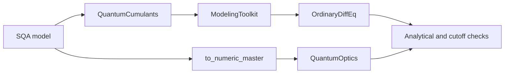

# Research workflow demonstrations

The saved results use Julia 1.13.2. Use the recorded runtime and resolved
manifests when reproducing their measurements.

These scripts support the two motivations for SecondQuantizedAlgebra: efficient
higher-order operator calculations and reuse of a symbolic model across tools.
They are separate from the cross-language kernel suite. They do not provide
another overall package ranking.

## Higher-order Schrieffer-Wolff calculation

Run from the repository root in the prepared comparison environment:

```sh
julia --project=benchmark benchmark/comparison/demonstrations/high_order.jl
```

`high_order.jl` applies the same graded Baker-Campbell-Hausdorff algorithm to
SQA and QuantumAlgebra. It starts from the Jaynes-Cummings Hamiltonian in the
cavity rotating frame, `H/Δ = σee + ε(a†σge + aσeg)`, with `ε = g/Δ`.

For this model the total excitation `M = a†a + σee` commutes with the
interaction. The known block rotation has the anti-Hermitian generator

```math
S = -\sum_{k=0}^{\infty}\frac{(-4)^k}{2k+1}\,
\epsilon^{2k+1} M^k(a^\dagger\sigma^{ge}-a\sigma^{eg}).
```

The script constructs this generator to the requested order, computes
`exp(S) H exp(-S)` through a graded commutator expansion, and explicitly
truncates every intermediate series. This times a complete model-specific
transformation, including rational coefficient arithmetic and cancellations.
It uses a known generator; it is not a general algorithm for solving for
Schrieffer-Wolff generators. The expansion parameter is represented by formal
series degree, with exact rational operator coefficients.

Every coefficient is checked against the independent expansion of the exact
JC excitation-block energies. Odd orders must vanish. At even degree `2k`,
the operator correction is

```math
(-1)^{k+1} C_{k-1}
\left[(a^\dagger a+1)^k\sigma^{ee}-(a^\dagger a)^k\sigma^{gg}\right],
```

where `C` denotes a Catalan number. A separate error plot compares the retained
ground-like energies with `(1-sqrt(1+4ε²n))/2` at `ε=0.1` and photon numbers
`n=0:4`, inside the convergence radius. Verification is outside timing.
`@inferred` checks the series return type for each algebra.

The output records warmed runtime samples, allocations, allocated bytes,
verified order, and native expression size. Native term counts depend on each
package's canonical basis and are not interchangeable measures of physics.
The default order sweep is 2:2:20; `SQA_SW_MAX_ORDER` selects another even upper
order. Results and SVG/PNG figures are written to `benchmark/comparison/results/`
unless `SQA_DEMO_OUTPUT` selects an archive directory.

## One model, two numerical routes

The interoperability demonstration has its own environment so it cannot
change the kernel benchmark resolution:

```sh
julia --project=benchmark/comparison/demonstrations -e 'import Pkg; Pkg.instantiate()'
julia --project=benchmark/comparison/demonstrations benchmark/comparison/demonstrations/interoperability.jl
```

The environment pins QuantumCumulants development revision
`bfe9b198a375f81be061f9af6d852dfcbcaa18fe` and uses the local SQA checkout.
Registered QuantumCumulants releases and its current default branch do not
resolve with SQA 0.14. This is evidence for the pinned development combination,
not a claim of released-version compatibility.



One SQA Hamiltonian and loss channel describe a driven, damped bosonic mode.
QuantumCumulants derives its first and second moment equations; ModelingToolkit
compiles them and OrdinaryDiffEq solves the resulting differential equations.
The same symbolic generator is converted to a Hamiltonian and collapse
operators for QuantumOptics' master-equation solver.

The retained moments close exactly for this quadratic Hamiltonian and linear
jump. Both routes are checked against the analytical coherent-state amplitude,
and the direct simulation is repeated at Fock dimensions 12 and 20 to check
truncation. The maximum error must be below `1e-8` for amplitudes, occupations,
cross-method agreement, and the cutoff comparison. This is a correctness and
interoperability demonstration, not a solver-speed comparison or a claim that
cumulant truncations are generally exact.

The JSON output records parameters, traces, all error checks, package versions,
the pinned QC revision, and the resolved environment hash. The local
`Manifest.toml` retains the exact environment used for reproduction.

## Verified local results

The saved twentieth-order calculation passes every operator coefficient check. Minimum warmed runtimes from this workstation are:

| Order | SQA | QuantumAlgebra | Ground-like energy error / Δ |
|---:|---:|---:|---:|
| 4 | 0.062 ms | 1.560 ms | 0.000116 |
| 12 | 8.145 ms | 362.357 ms | 1.91e-08 |
| 20 | 684.424 ms | 21833.534 ms | 6.18e-12 |

For the pinned interoperability environment, all eight agreement and cutoff checks pass; the largest error is `2.47e-11`, below the `1e-8` acceptance threshold. These measurements use the parameters and validation domains above. They do not imply performance or accuracy for unrelated models.
