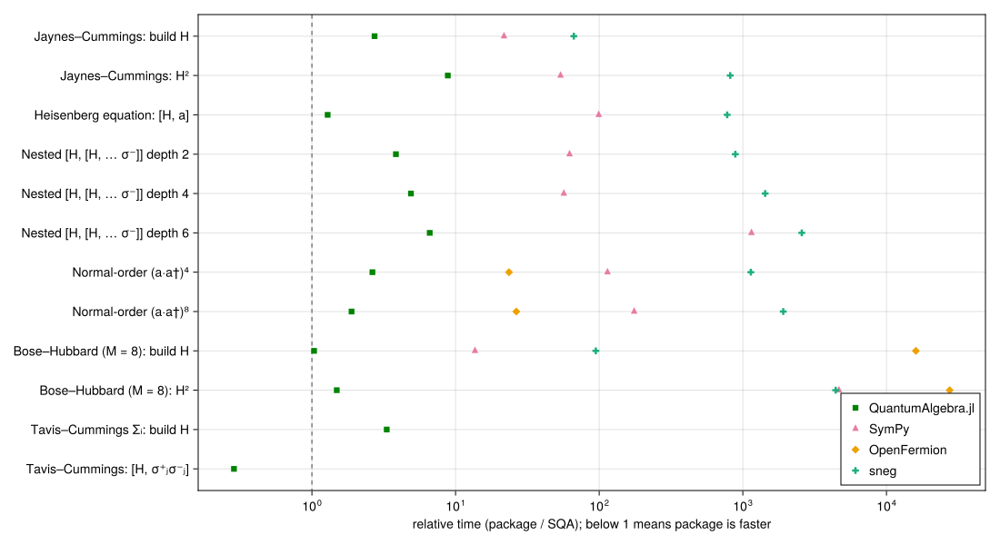
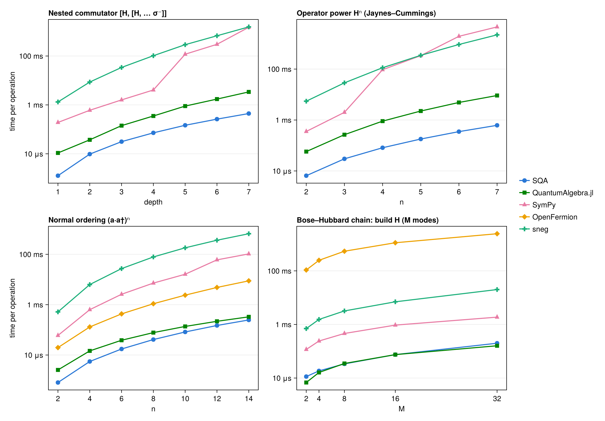
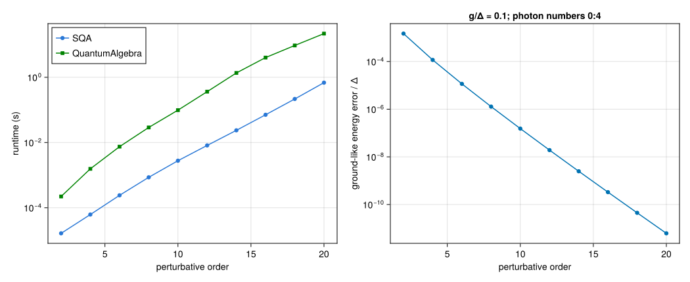

# Comparison with other packages

This suite compares symbolic operator calculations in SecondQuantizedAlgebra (SQA), [QuantumAlgebra.jl](https://github.com/jfeist/QuantumAlgebra.jl), [SymPy](https://docs.sympy.org/latest/modules/physics/quantum/index.html), [OpenFermion](https://quantumai.google/openfermion), and [SNEG](https://github.com/rokzitko/sneg). The benchmark contract and runners are in `benchmark/comparison/`.

The table below describes **coverage in these runners**, not the complete capabilities of the packages. An unimplemented case does not establish that a package cannot express it.

| Runner | JC model and commutators | Bosonic products and chains | Indexed TC contraction | Expectation interface |
|:--|:--:|:--:|:--:|:--:|
| SQA | yes | yes | yes | Symbolics expression |
| QuantumAlgebra | yes | yes | yes | native expectation expression |
| SymPy | yes | yes | not implemented | not implemented |
| OpenFermion | not implemented | yes | not implemented | not implemented |
| SNEG | yes | yes | not implemented | not implemented |

## Methodology

The `canonical-symbolic-v2` contract times physically equivalent calculations using each package's native canonical form. Elementary operators, spaces, parameters, and input Hamiltonians are prepared outside the timed algebra operations. Hamiltonian construction starts from predefined elementary operators. Repeated products normalize after every multiplication in every runner; the initial `a a†` factor is also prepared outside the normal-ordering sweep. All runners use symbolic real coefficients, including OpenFermion's SymPy coefficient path.

Before timing, the runners check primitive identities and representative scenario outputs. Independent targets include exact Stirling-number normal-order coefficients, analytical Heisenberg equations, and the indexed TC contraction. The Julia and SymPy runners also check nested commutators against a binomial expansion. These checks test the scenario families; they are not a proof of every library operation.

The suites run sequentially. Julia uses BenchmarkTools, Python uses pyperf, and Mathematica uses calibrated batches. The reported statistic is minimum warmed runtime; loading, compilation, and verification are excluded. Raw samples, Julia allocations and allocated bytes, resolved environments, runner sources, and hardware/settings are retained in the reproduction archive. A warmed call exceeding 30 seconds is marked `capped`; a separate package-job deadline includes loading and warmup. Failed or incomplete runs cannot replace this report.

Native canonical bases differ: SQA retains finite-level transitions, while the QA and SymPy cases use their native two-level representations. SymPy includes a timed helper to commute independent boson and Pauli factors. SNEG represents the two-level atom by one fermionic mode, whose single-site algebra is equivalent here. The indexed case measures a contraction with a free site index, not the elimination of a sum into an ensemble-size factor.

These are measurements from a single workstation and run. Cross-language harness and cache behavior differ, and minima are not uncertainty estimates. Assess the workload definition and scaling as well as the ratio; there is no aggregate package score. The older numeric-coefficient OpenFermion timings and raw-input QA powers belong to the previous contract and are not merged into this dataset.

## Results

<!-- comparison-results:start -->
Run `20261026T091522258607Z`; contract `canonical-symbolic-v2`; minimum warm runtime.

SQA 0.14.0 (Julia 1.13.2), QuantumAlgebra.jl 1.7.0 (Julia 1.13.2), SymPy 1.14.0 (Python 3.13.15), OpenFermion 1.8.1 (Python 3.13.15), sneg 2.1.1 (Mathematica 15.0).

| Benchmark | SQA | QuantumAlgebra.jl | SymPy | OpenFermion | sneg |
|---|---:|---:|---:|---:|---:|
| Jaynes–Cummings: build H | 2.250 μs | 6.140 μs (2.7×) | 48.922 μs (22×) | not implemented | 149.832 μs (67×) |
| Jaynes–Cummings: H² | 6.590 μs | 58.210 μs (8.8×) | 354.668 μs (54×) | not implemented | 5.381 ms (820×) |
| Heisenberg equation: [H, a] | 2.130 μs | 2.740 μs (1.3×) | 211.476 μs (99×) | not implemented | 1.657 ms (780×) |
| Nested [H, [H, … σ⁻]] depth 2 | 9.700 μs | 37.280 μs (3.8×) | 602.921 μs (62×) | not implemented | 8.602 ms (890×) |
| Nested [H, [H, … σ⁻]] depth 4 | 71.900 μs | 351.591 μs (4.9×) | 4.077 ms (57×) | not implemented | 102.843 ms (1400×) |
| Nested [H, [H, … σ⁻]] depth 6 | 261.691 μs | 1.729 ms (6.6×) | 300.573 ms (1100×) | not implemented | 673.068 ms (2600×) |
| Normal-order (a·a†)⁴ | 5.540 μs | 14.610 μs (2.6×) | 632.873 μs (110×) | 130.472 μs (24×) | 6.299 ms (1100×) |
| Normal-order (a·a†)⁸ | 41.190 μs | 77.741 μs (1.9×) | 7.212 ms (180×) | 1.090 ms (26×) | 78.747 ms (1900×) |
| Bose–Hubbard (M = 8): build H | 33.770 μs | 34.950 μs (1×) | 460.960 μs (14×) | 541.036 ms (16000×) | 3.198 ms (95×) |
| Bose–Hubbard (M = 8): H² | 556.251 μs | 828.203 μs (1.5×) | 2.597 s (4700×) | 15.319 s (28000×) | 2.464 s (4400×) |
| Tavis–Cummings Σᵢ: build H | 1.610 μs | 5.340 μs (3.3×) | not implemented | not implemented | not implemented |
| Tavis–Cummings: [H, σ⁺ⱼσ⁻ⱼ] | 22.650 μs | 6.490 μs (0.29×) | not implemented | not implemented | not implemented |
| Interface construction: ⟨H⟩ (different representations) | 36.810 μs | 1.170 μs | not implemented | not implemented | not implemented |

<!-- comparison-results:end -->

The SQA column gives absolute times. Parenthesized ratios are `package time / SQA time`: values below one mean that package is faster. The expectation-interface row produces different representations and therefore shows absolute times without a comparative ratio. `not implemented` describes missing runner coverage.



The overview includes the indexed commutator, including cases where SQA is slower. The dashed line denotes equal runtime. The expectation-interface row is excluded from this ranking.



The scaling panels vary commutator depth, operator power, normal-ordering power, and chain size. They measure algebra kernels, not complete perturbative methods. Native expression bases and output sizes need not be identical. Missing or capped points are not joined across a gap.

## Research workflow demonstrations

Two standalone scripts in `benchmark/comparison/demonstrations/` connect the kernels to the research motivation.

### Higher-order analytical calculation

`high_order.jl` applies the same graded Schrieffer-Wolff BCH calculation to SQA and QuantumAlgebra. It uses the known rotation generator for the Jaynes-Cummings model, truncates intermediate series by formal coupling order, and checks every coefficient against the independent exact excitation-block energy expansion. This is a complete model-specific transformation, not a general algorithm for finding perturbative generators. Coefficients are exact rationals; physical denominators enter through the expansion parameter `g/Δ`.



The runtime excludes verification and compilation. The energy-error panel uses the ground-like branch, `g/Δ=0.1`, and photon numbers 0:4. Native term counts, bytes, allocations, samples, and verified orders are recorded in `high_order.json`; native term counts depend on each algebra's basis. These timings describe this structured calculation and do not establish performance for every perturbative method.

### Shared symbolic model and numerical solvers

`interoperability.jl` defines one SQA Hamiltonian and loss channel for a driven, damped bosonic mode. QuantumCumulants derives the moment equations, ModelingToolkit compiles them, and OrdinaryDiffEq solves them. The same symbolic generator is converted for direct master-equation simulation with QuantumOptics. Both routes are checked against the analytical coherent-state solution; dimensions 12 and 20 check the numerical cutoff.

The first and second moments close exactly for this quadratic Hamiltonian and linear loss channel. This demonstrates reuse and numerical agreement, not a solver-speed comparison or general exactness of cumulant approximations. `interoperability.json` records the parameters, traces, package versions, and error checks.

The demonstration uses pinned QuantumCumulants development revision `bfe9b198a375f81be061f9af6d852dfcbcaa18fe`. Registered releases and the current default branch do not resolve with SQA 0.14. The evidence therefore applies to this pinned development combination. Its separate environment leaves the kernel comparison environment unchanged.

## [Reproducing](@id Reproducing)

Use the local entry point from the repository root:

```sh
python benchmark/comparison/run.py prepare
python benchmark/comparison/run.py run --sneg
python benchmark/comparison/run.py report benchmark/comparison/runs/RUN_ID --publish
```

SNEG is optional and requires an installed Mathematica kernel; `SNEG_PATH` may point to the directory containing `sneg.m`. Omitting `--sneg` runs the four-package core suite. `prepare --refresh` intentionally updates dependencies; ordinary preparation instantiates existing locks. `prepare --from-run PATH` restores an archive's environments after its source and runtime checks.

Each run is archived under `benchmark/comparison/runs/`. Published summary JSONs, the table, and `reproduction.tar.gz` are under `benchmark/comparison/results/`. The archive contains the raw samples, exact runner/environment snapshots, and the verified demonstration sources, environments, and results; the summary JSONs keep the tracked report readable. The report rejects mixed run IDs, contract hashes, source hashes, and incomplete coverage. Smoke runs can generate previews but cannot replace the published comparison.

Run the two research demonstrations separately:

```sh
julia --project=benchmark benchmark/comparison/demonstrations/high_order.jl
julia --project=benchmark/comparison/demonstrations -e 'import Pkg; Pkg.instantiate()'
julia --project=benchmark/comparison/demonstrations benchmark/comparison/demonstrations/interoperability.jl
```

The demonstration README gives the derivation, validation targets, parameters, and limits. Supporting examples and full benchmark records live in the repository; a JOSS paper can summarize and cite this evidence without reproducing code examples.
